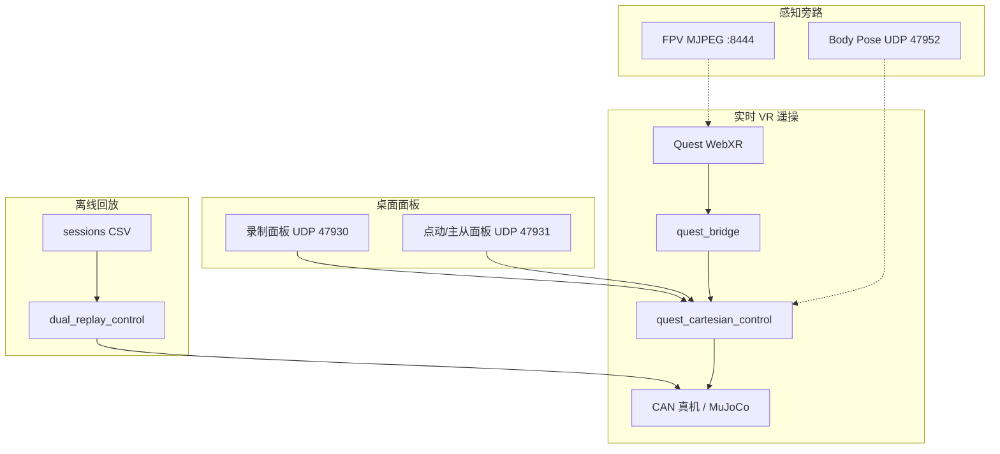

# 01 — 遥操链路总览

## 1. 本仓库有哪些「遥操链路」

`vr_control` 不是单一程序，而是多条可独立或组合运行的链路：



| # | 链路名 | 真机/仿真 | 是否日常主路径 | 文档 |
| --- | --- | --- | --- | --- |
| A | Quest 双臂实时（`human_mimic`） | 真机 | **是** | [02](02_PIPELINE_VR_LIVE.md) |
| B | Quest 单臂实时 | 真机 | 调试用 | [02](02_PIPELINE_VR_LIVE.md) |
| C | Quest 双臂/单臂仿真 | MuJoCo | 无 CAN 调试 | [02](02_PIPELINE_VR_LIVE.md) |
| D | 录制面板 | 真机/仿真 | 常开 | [03](03_PIPELINE_PANELS.md) |
| E | TCP 点动 + 主从锁定 + 画圆 | 真机/仿真 | 施教/微调 | [03](03_PIPELINE_PANELS.md) / [09](09_TECH_COUPLE_JOG.md) |
| F | FPV 相机 Bridge | — | 可选 | [04](04_PIPELINE_CAMERA_BODY.md) |
| G | Body Pose / HybrIK | 多与仿真联调 | 试验 | [04](04_PIPELINE_CAMERA_BODY.md) |
| H | 启动轨迹（steady CSV） | 嵌入 A/B/C | **是** | [02](02_PIPELINE_VR_LIVE.md) §启动动作 |
| I | 双臂/单臂 CSV 回放 | 真机/仿真 | 复现动作 | [05](05_PIPELINE_REPLAY.md) |
| J | 视觉抓取 / skewer topdown | 独立 | **不是** VR 遥操主链 | [06](06_PIPELINE_RELATED.md) |
| K | Fairino Python 遗留 | 外臂 | 非 OpenArm 主路径 | [06](06_PIPELINE_RELATED.md) |

---

## 2. 推荐日常路径（真机双臂）

```bash
# 终端 1（可选：Bridge + FPV）
./quest/run_quest_camera_bridge.sh

# 终端 2（控制 + 启动动作 + 面板）
OPENARM_QUEST_EXTRA_ARGS="--teleop-mode human_mimic" \
  ./quest/run_openarm_cartesian_bimanual.sh
```

Quest 打开脚本打印的 `https://<LAN-IP>:8443/client.html`。

要点：

- **必须**带 `--teleop-mode human_mimic`；省略时二进制默认 `cartesian_precision`
- 启动后先播 `recordings/tasks/steady_action_on_table.csv`，再允许 clutch
- Grip 按住跟手；松开冻结；夹爪 A/X 闭、B/Y 开

操作细节见 [SOP.md](../../SOP.md)。

---

## 3. 代码 / 脚本入口对照

| 角色 | 路径 |
| --- | --- |
| 双臂真机启动 | `quest/run_openarm_cartesian_bimanual.sh` |
| 双臂仿真 | `quest/run_openarm_cartesian_bimanual_sim.sh` |
| 单臂真机 / 仿真 | `quest/run_openarm_cartesian.sh` / `*_sim.sh` |
| Bridge + 相机 | `quest/run_quest_camera_bridge.sh` |
| Body Pose | `quest/run_body_pose_bridge.sh` |
| 点动/主从面板 | `quest/quest_tcp_jog_panel.py` |
| 录制面板 | `quest/quest_action_record_panel.py` |
| 控制二进制 | `openarm_teleop/openarm_inplace/build/quest_cartesian_control` |
| 回放二进制 | `…/build/dual_replay_control` |
| 双臂回放脚本 | `openarm_teleop/openarm_inplace/script/run_cpp_real_replay_both.sh` |
| CAN / 夹爪默认 | `openarm_teleop/openarm_inplace/script/openarm_vr_compat_env.sh` |
| URDF | `openarm_teleop/openarm_description/.../example/v1.urdf` |

---

## 4. 产物目录

| 产物 | 路径 |
| --- | --- |
| HM 诊断日志 | `openarm_teleop/openarm_inplace/recordings/hm_logs/quest_<时间戳>/` |
| 动作会话 | `…/recordings/sessions/<name>/` |
| 启动轨迹 | `…/recordings/tasks/steady_action_on_table.csv` |
| 位姿 dump | 会话目录下 `pose_snapshots.txt`（面板 Dump） |

---

## 5. 阅读顺序建议

1. 本文总览  
2. [02_PIPELINE_VR_LIVE.md](02_PIPELINE_VR_LIVE.md) — 弄清主数据流  
3. [07_TECH_CONTROL_STACK.md](07_TECH_CONTROL_STACK.md) + [08_TECH_FRAMES_MODES.md](08_TECH_FRAMES_MODES.md) — 控制与坐标系  
4. 按需：[03](03_PIPELINE_PANELS.md) 面板、[05](05_PIPELINE_REPLAY.md) 回放、[09](09_TECH_COUPLE_JOG.md) 主从/点动  
5. 速查：[10_PORTS_ENV.md](10_PORTS_ENV.md)
