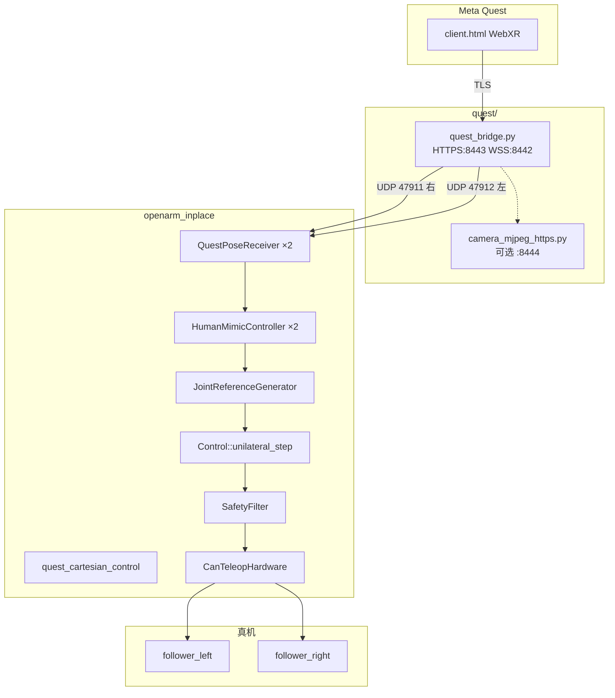
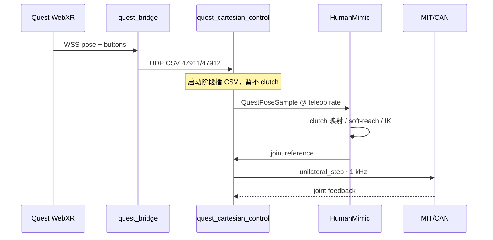

# 02 — VR 实时遥操链路（真机 / 仿真）

覆盖 Quest → Bridge → `quest_cartesian_control` → 电机（或 MuJoCo）的主实时路径。  
面板细节见 [03](03_PIPELINE_PANELS.md)；控制栈见 [07](07_TECH_CONTROL_STACK.md)。

---

## 1. 进程拓扑（双臂真机）



| 进程 | 典型启动 | 职责 |
| --- | --- | --- |
| `quest_bridge.py` | `run_quest_camera_bridge.sh` 或控制脚本自动拉起 | 托管 WebXR、WSS 收姿态、转 UDP |
| `camera_mjpeg_https.py` | 相机 bridge 脚本 | FPV（可选，不进控制环） |
| `quest_cartesian_control` | `run_openarm_cartesian_*.sh` | 启动动作 + 遥操控制环 |
| 录制/点动面板 | 控制脚本默认启动 | 见 [03](03_PIPELINE_PANELS.md) |

---

## 2. 入口脚本矩阵

| 场景 | 脚本 | 硬件后端 |
| --- | --- | --- |
| 双臂真机 | `quest/run_openarm_cartesian_bimanual.sh` | SocketCAN `follower_left` / `follower_right` |
| 双臂仿真 | `quest/run_openarm_cartesian_bimanual_sim.sh` | MuJoCo |
| 单臂真机 | `quest/run_openarm_cartesian.sh` | 单路 CAN（默认右） |
| 单臂仿真 | `quest/run_openarm_cartesian_sim.sh` | MuJoCo |

公共逻辑：`quest/quest_real_common.sh`（conda、构建、杀旧进程、拉 bridge）。  
CAN/夹爪默认：`openarm_teleop/openarm_inplace/script/openarm_vr_compat_env.sh`。

**产品推荐模式：**

```bash
OPENARM_QUEST_EXTRA_ARGS="--teleop-mode human_mimic" \
  ./quest/run_openarm_cartesian_bimanual.sh
```

---

## 3. 端到端数据流（时序）



频率量级：

- WebXR / Bridge：取决于 Quest 刷新（常几十 Hz）
- HM `step`：与参考线程绑定（常用 ~50–100 Hz 量级，以代码为准）
- `Control::unilateral_step`：约 **1 kHz**

---

## 4. 启动动作（Startup Trajectory）

控制进程起来后**不会立刻**接受 grip clutch，而是：

1. 读取当前关节（实测）  
2. Quintic 过渡到 CSV 首帧  
3. 按 CSV 播放整段轨迹  
4. Hold 末端位姿若干时间  
5. 才允许 VR clutch  

| 项 | 默认 |
| --- | --- |
| CSV | `openarm_teleop/openarm_inplace/recordings/tasks/steady_action_on_table.csv` |
| 覆盖 | `OPENARM_QUEST_STARTUP_FILE` |
| 关闭启动动作 | 视脚本/参数（见 SOP；勿在未确认安全时跳过） |

入口脚本 `run_openarm_cartesian_bimanual.sh` 会设置 `OPENARM_QUEST_STARTUP_FILE` 指向上述 steady CSV。

---

## 5. 控制环内部（单臂视角）

对左/右各有一套 `ArmTeleopBundle`：

```text
QuestPoseReceiver.latest()
  → HumanMimicController::step()
      clutch / map Δp,ΔR / soft-reach / elbow φ
      → solve_base_skeleton (IK)
      → JointReferenceGenerator
  → fill JointState reference
  → Control::unilateral_step (MIT-PD)
  → SafetyFilter
  → CanTeleopHardware / MujocoTeleopHardware
```

双臂时参考线程顺序：

- **普通**：左、右各 step  
- **主从锁定**：先右（主）→ `apply_couple_left_follow` → 再左（从）  

详见 [09_TECH_COUPLE_JOG.md](09_TECH_COUPLE_JOG.md)。

---

## 6. 遥操模式（`--teleop-mode`）

| 模式 | 启用 | 说明 |
| --- | --- | --- |
| **`human_mimic`** | EXTRA_ARGS **推荐** | soft-reach + 虚拟肘骨架；日常产品路径 |
| `cartesian_precision` | 不传 mode（二进制默认） | 末端 DLS 风格；无 HM soft-reach |
| `pika_style` | EXTRA_ARGS | 纯 6D DIFF_QP，试验 |
| `skeleton_proximal` | EXTRA_ARGS | 近端骨架 + 远端姿态；试验 |

坐标系与 soft-reach 细节：[08_TECH_FRAMES_MODES.md](08_TECH_FRAMES_MODES.md)。

---

## 7. 真机 vs 仿真差异

| 项 | 真机 | 仿真 |
| --- | --- | --- |
| 硬件 | SocketCAN | MuJoCo 后端 |
| CAN 名 | `follower_left` / `follower_right` | 无 |
| 增益 | `config/follower.yaml`；Quest 可用 `OPENARM_QUEST_MIT_SCALE` | 仿真增益 |
| Bridge | 仍需要（Quest → UDP） | 同左 |
| 启动 CSV | 默认开启 | 通常同样走启动逻辑 |

仿真入口示例：

```bash
OPENARM_QUEST_EXTRA_ARGS="--teleop-mode human_mimic" \
  ./quest/run_openarm_cartesian_bimanual_sim.sh
```

---

## 8. 日志与排障

| 现象 | 检查 |
| --- | --- |
| grip 无反应 | 是否已过启动动作；Quest 是否连上 `:8443`；UDP 是否有包 |
| 默认手感不对 | 是否漏了 `--teleop-mode human_mimic` |
| `:8443` 被占 | `ss -lntp \| grep 8443`；结束旧 `quest_bridge` |
| 手臂不跟/抖动 | `recordings/hm_logs/...`；软可达 / 关节限位 / CAN |

HM 日志目录：`openarm_teleop/openarm_inplace/recordings/hm_logs/quest_<时间戳>/`。
