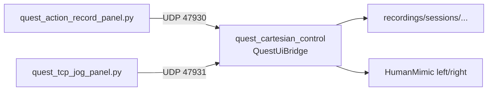

# 03 — 桌面面板链路（录制 / 点动 / 主从）

面板由 `quest_cartesian_control` 在 `OPENARM_QUEST_UI=1`（默认）时打开 UDP 端口；Python Tk 面板只发文本命令，不直接碰 CAN。

---

## 1. 总图



| 面板 | 脚本 | 端口 | 协议要点 |
| --- | --- | --- | --- |
| 动作录制 | `quest/quest_action_record_panel.py` | **47930** | `start,<name>` / `stop` / `dump,<name>` / 退出 |
| TCP 点动 + 主从 | `quest/quest_tcp_jog_panel.py` | **47931** | `hold/release` / `couple` / `circle` / `nudge` |

端口覆盖：`OPENARM_QUEST_UI_RECORD_PORT` / `OPENARM_QUEST_UI_JOG_PORT`。  
关闭面板：`OPENARM_QUEST_UI=0`。

---

## 2. 录制面板链路

### 2.1 流程

1. 用户在面板输入会话名 → `start,<name>`  
2. C++ 创建 `recordings/sessions/<name>/NN/` 分段目录  
3. 控制环每拍把左右关节参考写入 CSV  
4. `stop` 结束当前段；可再 `start` 新段  
5. 停止时常触发左右 CSV merge（供回放）  
6. `dump,<name>` 写入测量位姿快照（手眼/标定用，走实测 FK）

### 2.2 产物

```text
recordings/sessions/<name>/
  01/  left_*.csv  right_*.csv  merged_*.csv
  02/  ...
  pose_snapshots.txt          # dump
```

回放入口见 [05_PIPELINE_REPLAY.md](05_PIPELINE_REPLAY.md)。

---

## 3. TCP 点动面板链路

### 3.1 方向（机体基准）

相对 `openarm_body_link0`：

| 按钮 | 机体轴 |
| --- | --- |
| 上 / 下 | **+Z** / **−Z** |
| 左 / 右 | **+Y** / **−Y** |
| （无前后键） | +X 为前，仅作其它逻辑参考 |

速度权威在 C++：`OPENARM_QUEST_JOG_SPEED`（默认 0.02 m/s）。  
面板 `--speed` **仅显示**，不进 UDP。

### 3.2 命令

```text
hold,<left|right>,<up|down|left|right>
release,<left|right>,<up|down|left|right>
nudge,<left|right>,<up|down|left|right>     # 旧单步
couple,on|off|toggle
circle,start,<radius_mm>
circle,stop
```

### 3.3 控制侧行为

- Hold → `set_panel_jog_velocity` → 每拍积分机体轴目标 → Cartesian chase（连续 `q_target_slew`）  
- 无 grip 也可点动；有 grip 时点动叠加在 clutch 原点上  
- 仅 `human_mimic` / `pika_style` 等 HM 路径生效；纯 `cartesian_precision` 时面板可能无动作  

技术细节：[09_TECH_COUPLE_JOG.md](09_TECH_COUPLE_JOG.md)。

---

## 4. 主从锁定（Couple）

### 4.1 语义

- **右臂**：主臂；VR **只跟位置**，姿态锁定在 engage 瞬间  
- **左臂**：从臂；跟踪机体系固定偏置 `p_L = p_R + Δp₀`，姿态亦锁定  
- **不是**关节镜像，**不是**随主臂当前姿态旋转的刚体连杆  

### 4.2 流程

```mermaid
sequenceDiagram
  participant UI as jog panel
  participant QC as QuestUiBridge
  participant R as right HM
  participant L as left HM

  UI->>QC: couple,on
  QC->>QC: snapshot Δp, R_rel; freeze R_right
  QC->>R: orientation_lock
  QC->>L: orientation_lock + couple_follow
  loop each tick
    QC->>R: step VR position-only
    QC->>L: drive_tcp(p_R+Δp)
    QC->>L: step couple_follow stream
  end
```

连续性策略（摘要）：engage 冻结左肘 φ 支路；drive 保留关节 slew；禁止为追尖端而换解突变。  
环境变量见 [10_PORTS_ENV.md](10_PORTS_ENV.md) / SOP §6.5。

### 4.3 画圆

仅 couple 开启后可用：右臂 TCP 在机器人 **XY** 平面绕 engage 圆心转一圈；左臂相对跟随。

- `OPENARM_QUEST_CIRCLE_PERIOD`（默认 8 s）  
- `OPENARM_QUEST_CIRCLE_TIP_SPEED`（末端限速）  

---

## 5. 与主 VR 链路的关系

| 状态 | 右臂 | 左臂 |
| --- | --- | --- |
| 正常遥操 | VR clutch | VR clutch |
| Couple ON | VR 位置 + 姿态锁 | 无 VR；跟随几何目标 |
| Couple + 右点动 | 面板速度驱动 tip | 跟随 |
| Couple + 画圆 | 圆轨迹驱动 tip | 跟随 |
| Couple 时左点动 | — | **忽略**（从臂） |
