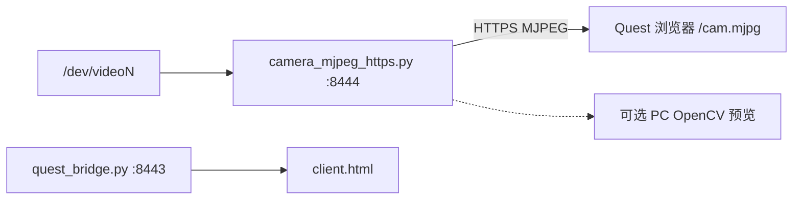

# 04 — 相机 FPV 与 Body Pose 链路

这两条都是**感知旁路**：不替代 MIT 控制律；相机给人看，Body Pose 给试验性骨架提示。

---

## 1. FPV 相机 Bridge

### 1.1 目的

让 Quest 浏览器额外看到机器人侧第一视角 MJPEG，便于遥操对位。  
**不进入** `quest_cartesian_control` 控制环。

### 1.2 拓扑



### 1.3 入口

```bash
./quest/run_quest_camera_bridge.sh
```

会：

1. 结束旧 `quest_bridge` / `camera_mjpeg_https`  
2. 拉起 Bridge（`:8443`）+ 相机 HTTPS（`:8444`）  
3. 可选本机预览窗（`OPENARM_QUEST_CAMERA_PREVIEW=1`）

| 变量 | 默认 | 说明 |
| --- | --- | --- |
| `OPENARM_QUEST_CAMERA` | `16` | `/dev/video16` |
| `OPENARM_QUEST_CAMERA_PORT` | `8444` | MJPEG HTTPS |
| `OPENARM_QUEST_HTTP_PORT` | `8443` | WebXR |
| `OPENARM_QUEST_CAMERA_PREVIEW` | `1` | PC 预览 |

独立预览：`quest/preview_cam_mjpeg.sh`、`preview_camera_live.py`。

Quest 需**单独信任一次** `:8444` 证书。

---

## 2. Body Pose Bridge（试验）

### 2.1 目的

从相机估计人体骨架，UDP 发给控制端做可视化/躯干映射（`--body-pose`）。**默认不直接驱动关节**。

另有两条会进控制环的 HybrIK 旁路（与 body-pose 不同）：

| 桥 | 端口 | 控制侧 |
| --- | --- | --- |
| 肘 φ swivel | **47950** | `--elbow-hint hybrik`（可叠在 `human_mimic`） |
| SEW 近端 | **47951** | `--teleop-mode skeleton_proximal` |

### 2.2 拓扑


### 2.3 入口

```bash
# 终端 A：身体桥
./quest/run_body_pose_bridge.sh

# 终端 B：常配合仿真
OPENARM_QUEST_EXTRA_ARGS="--body-pose --teleop-mode human_mimic" \
  ./quest/run_openarm_cartesian_bimanual_sim.sh
```

| 变量 | 默认 | 说明 |
| --- | --- | --- |
| `OPENARM_BODY_POSE_PORT` | `47952` | UDP |
| `OPENARM_BODY_POSE_BACKEND` | `hybrik` | 或 `mediapipe` |
| `OPENARM_HYBRIK_CAM` | `8` | 相机号 |
| Conda | `hybrik` | 与 `openarm_quest` 不同环境 |

代码：`quest/body_pose_bridge.py`、仓库内 `HybrIK/`（若已部署）。

---

## 3. 和主遥操的组合方式

| 组合 | 说明 |
| --- | --- |
| 仅 Bridge | 手柄遥操，无 FPV |
| Bridge + Cam | **推荐**真机对位 |
| Bridge + Body | 试验骨架；勿与未验证增益同开真机 |
| Cam 单独预览 | 不遥操时看画面 |
