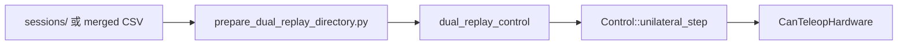

# 05 — 录制与回放链路

实时遥操录下的是**关节参考 CSV**（不是视频、不是 CAN 原始帧）。回放把 CSV 再灌进同一套 `Control::unilateral_step`。

更底层设计见 [openarm_inplace/docs/TECHNICAL_DESIGN.md](../../openarm_teleop/openarm_inplace/docs/TECHNICAL_DESIGN.md)。

---

## 1. 录制（来自 VR 遥操）

来源：[03_PIPELINE_PANELS.md](03_PIPELINE_PANELS.md) 录制面板 → `QuestUiBridge`。

```text
遥操 reference
  → CsvRecorder left/right
  → recordings/sessions/<name>/<segment>/*.csv
  →（停止时）merge 脚本生成合并 CSV
```

也可用 inplace 脚本在**非 Quest**场景录制，例如：

- `script/run_cpp_real_teleop_record_both.sh`
- `script/run_cpp_real_follower_record_both.sh`

---

## 2. 双臂回放（真机主路径）

### 2.1 拓扑



### 2.2 入口

```bash
cd openarm_teleop/openarm_inplace
./script/run_cpp_real_replay_both.sh recordings/sessions/<session_name>
# 或
./script/run_cpp_real_replay_panel.sh   # GUI 选会话
```

二进制：`build/dual_replay_control`。

要点：

- 回放**固定**使用 `follower.yaml` 增益；**不受** `OPENARM_QUEST_MIT_SCALE` 影响  
- 启动常有 gain ramp / auto home（脚本内 `REPLAY_*` 变量）  
- 可先 `prepare_dual_replay_directory.py` 规范化左右 CSV  

### 2.3 服务化 / 视觉编排后端

```bash
./script/run_cpp_real_replay_server.sh
```

常驻 `dual_replay_control`，UDP **47970**（cmd）/ **47971**（status），供视觉抓取脚本 `play|<csv>`。  
勿与正在跑的 `quest_cartesian_control` 抢同一 CAN。

电机日志：`recordings/motor_logs/`（`OPENARM_REPLAY_MOTOR_LOG`）。

### 2.3 辅助

| 脚本 | 作用 |
| --- | --- |
| `smooth_replay_csv.py` | CSV 平滑 |
| `generate_cubic_bezier_replay.py` | 生成测试轨迹 |
| `run_cpp_real_goto_pose.sh` | 去往快照位姿 |
| `run_quest_02_align_03.sh` | 特定对齐动作编排（含 replay） |

---

## 3. 数据流对比：遥操 vs 回放

| | 实时 VR | CSV 回放 |
| --- | --- | --- |
| Reference 来源 | HumanMimic / 面板 | CSV 时间序列 |
| 姿态映射 | Quest clutch | 无 |
| 控制律 | 同 `unilateral_step` | 同 |
| 硬件 | CAN / MuJoCo | CAN / MuJoCo |
| 典型二进制 | `quest_cartesian_control` | `dual_replay_control` |

```text
[VR / 面板 / CSV] → reference → Control → SafetyFilter → Hardware
```

---

## 4. 产物约定

```text
recordings/
  tasks/
    steady_action_on_table.csv     # VR 启动轨迹
  sessions/
    <name>/
      01/ … merged …
      pose_snapshots.txt
  hm_logs/
    quest_<ts>/                    # HM 诊断，非回放输入
```
